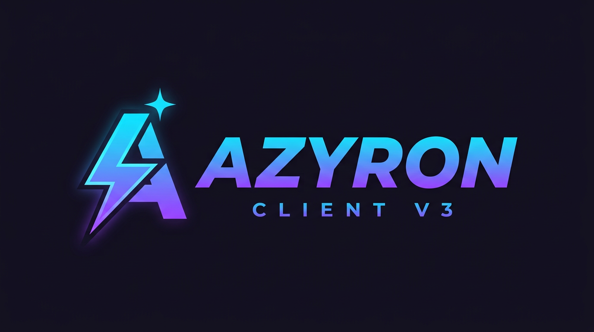

# AZYRON CLIENT V3



**Premium multi-version Minecraft: Java Edition client — built for Android / PojavLauncher and low-end PCs.**
By **JIGNESH GAMING** · version **3.0.0** · Fabric · MIT

> ⚠️ **Honesty notice (read this first)**
> No jar is committed to this repository yet. The four mod jars are produced
> by the `AZYRON CLIENT V3 Build` workflow (see `.github/workflows/azyron-build.yml`
> at the repo root) from these exact sources. Until that workflow has run
> green for a version, that version is **not** claimed to be built or tested.
> Performance numbers are **not** promised; stability is prioritized over
> mod count and over FPS claims.

## What this is

AZYRON CLIENT V3 is a **client-side Fabric mod** (not a launcher rebrand and
not a fake client). It adds:

- A custom **AZYRON** interface: title-screen entry button → home hub with
  navigation (FPS BOOST, HUD LAYOUT, HUD SETTINGS, VERSIONS, CLIENT SETTINGS),
  live status panel and an about page — dark premium UI in purple +
  electric blue, flat lightweight rendering (PojavLauncher-friendly).
- An **HUD suite**: FPS, CPS (L/R), ping (with color dot), coordinates,
  keystrokes grid and armor bar. Every element can be **enabled/disabled,
  moved, nudged, scaled (0.5–2.0) and recolored**, or dragged in the visual
  **layout editor**. Layout persists in `config/azyronclient-v3.properties`.
- **FPS BOOST**: one-click optimizer + three profiles:
  - **POTATO** — render distance 2, simulation distance 2, graphics Fast,
    max FPS 60, particles minimal, clouds off, smooth lighting off,
    entity distance 50%, mipmaps 0, vsync off, biome blend 0, entity
    shadows off (the exact AZYRON low-spec used on low-end Android),
  - **BALANCED**, **SMOOTH** — see [docs/FPS-BOOST.md](docs/FPS-BOOST.md).
  The optimizer itself runs through version-tolerant reflection; settings
  that don't exist on a given game version are reported as `SKIPPED`, never
  crash. Auto-apply on first launch is on by default (toggle in settings).
- **Auto sprint** while holding forward (Android-friendly), toggleable.
- **Version detection + selector page**: MC version is auto-detected from
  the loader; the VERSIONS page lists every AZYRON build and how to switch.
- A **modpack definition** per version (`modpack/`) that fetches genuine
  performance mods (Sodium, Lithium, FerriteCore, ImmediatelyFast, Entity
  Culling, More Culling, Dynamic FPS) from Modrinth/Fabric Maven at install
  time — nothing is bundled or faked, and **ModernFix is deliberately
  omitted** because no Fabric builds exist for any target version.

## Supported versions

| Minecraft | Java | Loader | Fabric API | Build status |
|-----------|------|--------|------------|--------------|
| 1.21.11 | 21 | Fabric 0.20.1 | 0.141.6+1.21.11 | pending CI (`.github/workflows/azyron-build.yml`) |
| 26.1 | 25 | Fabric 0.20.1 | 0.145.1+26.1 | pending CI |
| 26.2 | 25 | Fabric 0.20.1 | 0.161.0+26.2 | pending CI |
| 26.3 | 25 | Fabric 0.20.1 | 0.165.2+26.3 | pending CI |

Independent builds, independent source flavors, shared core — APIs are never
mixed between versions. See `docs/COMPATIBILITY.md` for the full matrix,
and `docs/API-VERIFICATION.md` for what was verified against upstream
sources (and what still needs an in-game test). Build internals are in
[docs/BUILD-CONFIG.md](docs/BUILD-CONFIG.md).

## Install

Full instructions — including **PojavLauncher on Android** and a per-version
troubleshooting table — live in `release/<mc>/INSTALL.md`:

- [1.21.11](release/1.21.11/INSTALL.md) · [26.1](release/26.1/INSTALL.md) · [26.2](release/26.2/INSTALL.md) · [26.3](release/26.3/INSTALL.md)

Short version: drop `fabric-api-<pinned>.jar` + the recommended performance
mods (fetch them via `modpack/_shared/fetch-mods.sh <mc>`) + the AZYRON jar
from CI into the profile's `mods/` folder and launch.

**Downloading a build:** run Actions → *AZYRON CLIENT V3 Build* → *Run
workflow* with `publish = prerelease`, and the four jars are attached to
[`releases/tag/v3.0.0-beta.1`](https://github.com/blazemc125/Azyron-Client/releases/tag/v3.0.0-beta.1).
That tag only exists after a green run — see `release/PRE-RELEASE-NOTES.md`
for what the pre-release does and does not promise.

## Building from source

```sh
cd azyron-client
chmod +x gradlew
./gradlew :versions:v1_21_11:build   # Java 21 for 1.21.11
./gradlew :versions:v26_3:build      # Java 25 for 26.x
```

Requires a full JDK 21 or 25, network access to `maven.fabricmc.net`,
Mojang's hosts and `services.gradle.org`. Output:
`versions/<flavor>/build/libs/azyron-client-<mc>-3.0.0.jar` (remapped).

Version pins (`mc_version`, `fabric_api_version`, `java_release`, …) live in
each `versions/<flavor>/build.gradle`; there are no subproject
`gradle.properties` files. Why that is the case — and why client classes
still end up in the jar — is explained in
[docs/BUILD-CONFIG.md](docs/BUILD-CONFIG.md).

## Troubleshooting (quick)

| Symptom | Fix |
|---------|-----|
| Crash on startup, `Unsupported class file major version` | Wrong Java: 1.21.11 needs **21**, 26.x needs **25**. |
| `requires fabric-api` | Wrong/missing Fabric API build — use the pinned one from `release/<mc>/INSTALL.md`. |
| AZYRON button missing | Jar not loaded: check `logs/latest.log`; wrong game version for this jar. |
| HUD invisible | F1 (hide GUI) or debug screen is open; elements can be toggled in HUD SETTINGS. |
| Reset everything | Delete `config/azyronclient-v3.properties` in the game directory. |

## Credits

- **JIGNESH GAMING** — AZYRON CLIENT V3 design & development
- FabricMC, Mojang, and the authors of Sodium, Lithium, FerriteCore,
  ImmediatelyFast, Entity Culling, More Culling and Dynamic FPS
  (fetched separately, each under its own license)

## License

MIT — see `LICENSE`. AZYRON branding is part of this project; the Fabric
mod may not redistribute other projects' binaries without permission.
